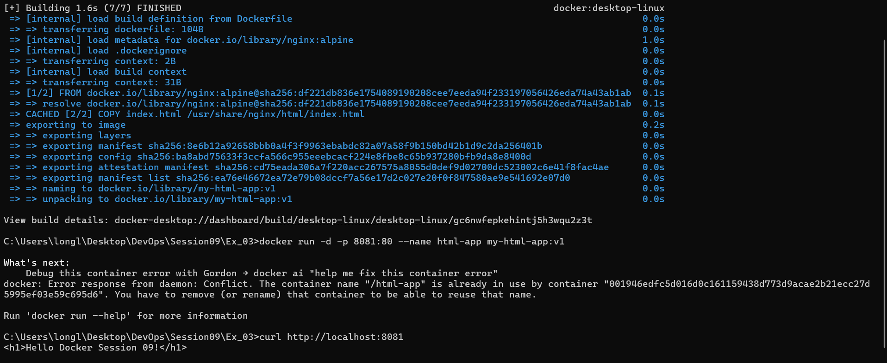

# Session 09 - Exercise 03: Đóng gói trang Web HTML tĩnh với Docker

## Các bước thực hiện

### 1. Build Docker Image
Chạy lệnh sau tại thư mục chứa `Dockerfile`:
```bash
docker build -t my-html-app:v1 .
```

### 2. Khởi chạy Docker Container
Chạy container từ image vừa build trên cổng `8081`:
```bash
docker run -d -p 8081:80 --name html-app my-html-app:v1
```

### 3. Kiểm tra kết quả
Sử dụng lệnh `curl` hoặc truy cập trình duyệt tại `http://localhost:8081`:
```bash
curl http://localhost:8081
```

**Kết quả mong đợi:**
```html
<h1>Hello Docker Session 09!</h1>
```


### 4. Dọn dẹp container (khi hoàn thành kiểm tra)
```bash
docker stop html-app
docker rm html-app
```
